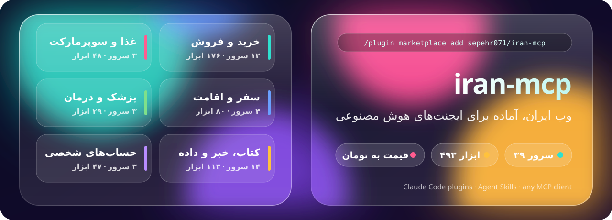
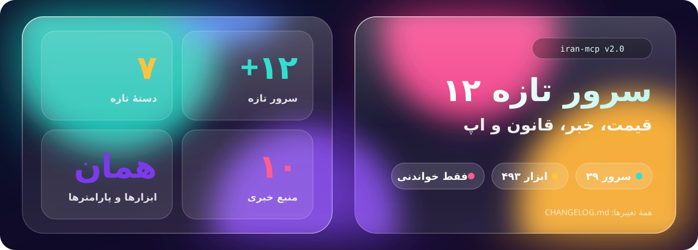

<div align="center">



[English](README.md) · **فارسی**

</div>

<div dir="rtl">

# سرور MCP برای سایت‌های ایرانی: iran-mcp

<p align="center">
<b>وب ایران را به ایجنت هوش مصنوعی‌تان بدهید.</b><br>
۳۶ سرور MCP متن‌باز و غیررسمی برای ایران و سایت‌های فارسی: دیجی‌کالا، ترب، دیوار، اسنپ‌فود، جاباما، مستربلیط، پذیرش۲۴، طاقچه، بورس تهران، صرافی رمزارز ایرانی، سازمان امور مالیاتی، سامانهٔ قوانین و بقیه، به‌اضافهٔ سرورهای رسمی اکسیریاب، پس‌آورد و سواپ‌ولت.<br>
جست‌وجو، مقایسهٔ قیمت به تومان، پیدا کردن نوبت خالی و تخفیف‌های امروز، از داخل Claude، Cursor، GitHub Copilot در VS Code یا هر کلاینت MCP.<br>
به‌صورت پلاگین Claude Code همراه با اسکیل نصب کنید، یا به‌صورت Agent Skills برای Codex، Cursor، Antigravity و Grok Build.
</p>

<p align="center">
<a href="#تازه‌های-نسخهٔ-۲۰">تازه‌ها</a> · <a href="#سرورها">سرورها</a> · <a href="#شروع-سریع">شروع سریع</a> · <a href="#برای-ایجنت‌ها">برای ایجنت‌ها</a> · <a href="TOOLS.md">همهٔ ابزارها</a> · <a href="#پرسش‌های-رایج">پرسش‌های رایج</a>
</p>

---

## تازه‌های نسخهٔ ۲٫۰



- **۱۲ سرور تازه**، همه فقط‌خواندنی و بی‌نیاز از ورود به حساب: در مجموع ۳۶ سرور و ۴۶۹ ابزار.
- **فروشگاه و غذا:** [basalam-mcp](https://github.com/sepehr071/basalam-mcp) (هزاران غرفه‌دار کوچک)، [banimode-mcp](https://github.com/sepehr071/banimode-mcp) (مد و پوشاک)، [baneh-mcp](https://github.com/sepehr071/baneh-mcp) (لوازم خانگی، تلویزیون و ابزار) و [tapsifood-mcp](https://github.com/sepehr071/tapsifood-mcp) (غذا و تخفیف‌های نزدیک یک آدرس).
- **قیمت، خبر و اسناد عمومی:** [tgju-mcp](https://github.com/sepehr071/tgju-mcp) (طلا، سکه، ارز و رمزارز)، [iran-news-mcp](https://github.com/sepehr071/iran-news-mcp) (۱۰ منبع خبری و ابزار اخبار فناوری)، [iran-quake-mcp](https://github.com/sepehr071/iran-quake-mcp) (زمین‌لرزه)، [qavanin-mcp](https://github.com/sepehr071/qavanin-mcp) (قوانین کشور) و [iran-tax-mcp](https://github.com/sepehr071/iran-tax-mcp) (شناسهٔ کالا در صورتحساب الکترونیکی، نرخ مالیات بر ارزش افزوده، آرای مالیاتی).
- **دوره، اپ و نرم‌افزار:** [maktabkhooneh-mcp](https://github.com/sepehr071/maktabkhooneh-mcp) (نام ابزارهایش با `mkh_` شروع می‌شود)، [iran-apps-mcp](https://github.com/sepehr071/iran-apps-mcp) (کافه‌بازار و مایکت) و [iran-downloads-mcp](https://github.com/sepehr071/iran-downloads-mcp) (جست‌وجو در سایت‌های دانلود، فقط نشانی صفحهٔ آیتم و هرگز لینک دانلود).
- **بستهٔ تازه:** `iran-fashion` و `iran-software`.
- نام ابزارها و پارامترهای سرورهای قبلی تغییری نکرده است.

فهرست کامل: [CHANGELOG.md](CHANGELOG.md) (انگلیسی).

<details>
<summary><b>تازه‌های نسخهٔ ۱٫۷</b></summary>


- **مسدودی و خطای کمتر.** ۱۸ سرور غیررسمی فروشگاهی حالا مثل یک مرورگر معمولی با سایت حرف می‌زنند، درخواست‌ها را آرام‌تر می‌فرستند و هر وقت سایت بخواهد صبر می‌کنند. کلاینت قبلی بعد از ۴ تا ۶ درخواست از ترب مسدود می‌شد؛ کلاینت تازه ۱۰۰ درخواست فرستاد و مسدود نشد.
- **فهرست پراکسی.** متغیر `<NAME>_MCP_PROXY` چند پراکسی جداشده با کاما می‌گیرد. اگر یکی مسدود شود، بعدی جایش را می‌گیرد.
- **مرورگر پشتیبان اختیاری** برای سایت‌هایی که صفحهٔ تشخیص ربات نشان می‌دهند: نسخهٔ `<package>[browser]` را نصب کنید.
- **تازه: [torob-mcp](https://github.com/sepehr071/torob-mcp)** (قیمت همهٔ فروشگاه‌های ایران برای یک کالا)، **[pasavard-mcp](https://github.com/ashkancapella/pasavard-mcp)** (میزبانی‌شده، بهترین خرید برای هر بودجه) و **[exiryab-mcp](https://github.com/sshnevis/exiryab-mcp)** (سرور رسمی اکسیریاب برای پیدا کردن پزشک).
- نام ابزارها و پارامترها تغییری نکرده است.

فهرست کامل: [CHANGELOG.md](CHANGELOG.md) (انگلیسی).
</details>

<details>
<summary><b>تازه‌های نسخهٔ ۱٫۵</b></summary>


- **حدود ۶۲٪ توکن کمتر در هر فراخوانی ابزار** و فهرست ابزار ۱۹٪ کوچک‌تر در ۱۹ سرور پایتونی، با همان رتبه‌بندی و ارزان‌ترین قیمت‌های قبل.
- **امنیت بیشتر** در سی‌بوک، بله و اکالا، و در همهٔ سرورها متن سایت داده‌ای نامطمئن حساب می‌شود.
- **کش، درخواست‌های موازی و تلاش دوباره** هر جا که سرورها کند یا شکننده بودند.
- **تازه: [divar-mcp](https://github.com/sepehr071/divar-mcp)**، ۳۱ ابزار برای آگهی‌های دیوار: خانه، خودرو، موبایل، سنجش قیمت و هشدار آگهی تازه.

فهرست کامل، با تغییرهایی که روی کلاینت‌ها اثر دارد: [CHANGELOG.md](CHANGELOG.md) (انگلیسی).
</details>

## چرا؟

سایت‌های ایرانی برای ایجنت‌ها ساخته نشده‌اند. بیشترشان API عمومی ندارند، یک صفحه قیمت را ریال نشان می‌دهد و صفحهٔ بعد تومان، و هر سایت بهترین تخفیف‌هایش را پشت یک منوی متفاوت پنهان کرده است. هر سرور پایتونی این مجموعه API واقعی (و مستندنشدهٔ) یک سایت را نقشه‌برداری و تست کرده و آن را به شکل ابزارهای تمیز MCP با قیمت **تومان** در اختیار ایجنت می‌گذارد. `exiryab-mcp`، `pasavard-mcp` و `swapwallet-mcp` سرورهای خود اکسیریاب، پس‌آورد و سواپ‌ولت‌اند و روی API مستند خودشان ساخته شده‌اند.

چند سرور را کنار هم بگذارید تا یک جمله کار یک روز گشتن بین تب‌ها را انجام دهد (مثال نمایشی):

> **شما:** پنجشنبهٔ آینده از تهران به کیش می‌روم، سه شب. ارزان‌ترین پرواز، ویلای زیر شبی ۴ میلیون تومان، و یک متخصص پوست در کیش با نوبت خالی.
>
> **ایجنت:** پرواز از `mrbilit`، اقامتگاه از `jabama` و `otaghak`، پزشک از `paziresh24`
>
> | | انتخاب | قیمت (تومان) |
> |---|---|---:|
> | پرواز | پنجشنبه ۰۷:۴۰، اکونومی، ۲ صندلی باقی‌مانده | ۲٬۱۸۰٬۰۰۰ |
> | اقامت | ویلای دوخوابه نزدیک ساحل، ۴٫۸ ستاره | ۳٬۶۵۰٬۰۰۰ برای هر شب |
> | پزشک | متخصص پوست، شنبه ۱۰:۳۰، حضوری | ۴۵۰٬۰۰۰ |

## شروع سریع

هر سرور یک پکیج کوچک پایتون روی PyPI است که با [`uvx`](https://docs.astral.sh/uv/) اجرا می‌شود، جز `pasavard-mcp` و `swapwallet-mcp` که خود سایت‌ها میزبانی‌شان می‌کنند: با آدرس اضافه‌شان می‌کنید و برای سواپ‌ولت یک بار با OAuth وارد حساب می‌شوید. سرورهای سایت‌ها نه حساب می‌خواهند و نه کلید API. `payping-mcp` و `bale-mcp` با توکن شما روی حساب خودتان کار می‌کنند و `swapwallet-mcp` با ورود شما به سواپ‌ولت.

**پلاگین‌های Claude Code** (سرور + اسکیل، هر کدام را که خواستید): یک بار مارکت‌پلیس را اضافه کنید، بعد سرورها را در تب Discover دستور `/plugin` انتخاب کنید یا با نام نصب کنید.

</div>

```bash
claude plugin marketplace add sepehr071/iran-mcp
claude plugin install digikala@iran-mcp            # one server
claude plugin install iran-travel@iran-mcp         # a bundle: food, shopping, beauty, travel, health, books
claude plugin install iran-all@iran-mcp            # every read-only site server
```

<div dir="rtl">

دستور `claude plugin install <name> --marketplace sepehr071/iran-mcp` هر دو مرحله را با یک دستور انجام می‌دهد. `payping`، `bale` و `swapwallet` روی حساب خودتان کار می‌کنند، برای همین در هیچ بسته‌ای نیستند؛ آن‌ها را با نام نصب کنید. سواپ‌ولت همین سرور را با همین قوانین به‌صورت پلاگین خودش هم منتشر کرده است (`swapwallet@swapwallet` از [SwapWallet/swapwallet-mcp](https://github.com/SwapWallet/swapwallet-mcp)). فقط یکی از این دو را نصب کنید، وگرنه سرور دو بار اضافه می‌شود.

**اسکیل برای ایجنت‌های دیگر** (Codex، Cursor، Gemini CLI و ...): اسکیل‌های لازم را انتخاب کنید و بعد هر سرور را با کانفیگ پایین اضافه کنید.

</div>

```bash
npx skills add sepehr071/iran-mcp
```

<div dir="rtl">

**Grok Build** همین مارکت‌پلیس را می‌خواند: `grok plugin marketplace add sepehr071/iran-mcp`، بعد سرورها را یکی‌یکی نصب کنید (Grok اعضای بسته‌ها را نصب نمی‌کند). اینکه هر ایجنت چه چیزی را پشتیبانی می‌کند: [PLUGINS.md](PLUGINS.md#compatibility).

**یک سرور** (Claude Code، بدون پلاگین):

</div>

```bash
claude mcp add digikala -- uvx digikala-mcp
claude mcp add --transport http swapwallet https://swapwallet.app/mcp   # hosted; then sign in from /mcp
claude mcp add --transport http pasavard https://pasavard.ir/api/mcp      # hosted, no sign-in
```

<div dir="rtl">

**هر کلاینت MCP** (Claude Desktop، Cursor، Windsurf، VS Code و ...):

</div>

```json
{
  "mcpServers": {
    "digikala": { "command": "uvx", "args": ["digikala-mcp"] },
    "jabama":   { "command": "uvx", "args": ["jabama-mcp"] }
  }
}
```

<div dir="rtl">

`swapwallet-mcp` با آدرسش اضافه می‌شود و هر کلاینت آدرس را به شکل خودش می‌گیرد (Windsurf با `serverUrl`، و Claude Desktop از Settings ← Connectors): [راه‌اندازی آن در هر کلاینت](https://github.com/SwapWallet/swapwallet-mcp#connect).

**هر ۴۰ سرور با هم:** این مخزن را کلون کنید و در Claude Code باز کنید. فایل [`.mcp.json`](.mcp.json) همهٔ سرورها را ثبت می‌کند؛ هر کدام را که لازم دارید تأیید کنید.

</div>

```bash
git clone https://github.com/sepehr071/iran-mcp
cd iran-mcp && claude
```

<div dir="rtl">

> [!TIP]
> ۴۹۶ ابزار کانتکست زیادی می‌گیرد. به‌جای همه، فقط سرورهای لازم برای همان کار را فعال کنید.

## سرورها

### 🛒 خرید

| سرور | سایت | ابزار | نسخه | آخرین تغییر | ایجنت چه می‌تواند بکند |
|---|---|---:|:---:|:---:|---|
| [digikala-mcp](https://github.com/sepehr071/digikala-mcp) | [دیجی‌کالا](https://www.digikala.com) (با فرش) | ۲۳ | [](https://pypi.org/project/digikala-mcp/) | [](https://github.com/sepehr071/digikala-mcp/commits/main) | جست‌وجو با فیلتر ویژگی، بهترین انتخاب برای یک بودجه، همهٔ فروشنده‌ها، تاریخچهٔ قیمت، نظرها، تخفیف‌ها |
| [technolife-mcp](https://github.com/sepehr071/technolife-mcp) | [تکنولایف](https://www.technolife.com) | ۱۹ | [](https://pypi.org/project/technolife-mcp/) | [](https://github.com/sepehr071/technolife-mcp/commits/main) | کالای دیجیتال: قیمت نقد و اقساط هر فروشنده، مشخصات، نظرها، تخفیف‌ها |
| [masterkala-mcp](https://github.com/sepehr071/masterkala-mcp) | [مسترکالا](https://masterkala.com) | ۱۴ | [](https://pypi.org/project/masterkala-mcp/) | [](https://github.com/sepehr071/masterkala-mcp/commits/main) | گجت و لوازم جانبی: قیمت، مشخصات، تخفیف‌ها |
| [baneh-mcp](https://github.com/sepehr071/baneh-mcp) | [بانه](https://baaneeh.com) | ۷ | [](https://pypi.org/project/baneh-mcp/) | [](https://github.com/sepehr071/baneh-mcp/commits/main) | لوازم خانگی، تلویزیون و کالای دیجیتال: ارزان‌ترین قیمت کالای موجود، برندها، نظرها |
| [torob-mcp](https://github.com/sepehr071/torob-mcp) | [ترب](https://torob.com) (مقایسهٔ قیمت) | ۲۶ | [](https://pypi.org/project/torob-mcp/) | [](https://github.com/sepehr071/torob-mcp/commits/main) | قیمت همهٔ فروشگاه‌ها برای یک کالا، تاریخچهٔ قیمت، سنجش خرید، اقساط، ارزان‌ترین فروشگاه برای یک سبد |
| [basalam-mcp](https://github.com/sepehr071/basalam-mcp) | [باسلام](https://basalam.com) (بازار غرفه‌ها) | ۷ | [](https://pypi.org/project/basalam-mcp/) | [](https://github.com/sepehr071/basalam-mcp/commits/main) | کالای هزاران غرفهٔ کوچک: فیلتر قیمت، ارسال و تخفیف، ارزان‌ترین پیشنهاد، امتیاز غرفه، نظرها |
| [shopino-mcp](https://github.com/sepehr071/shopino-mcp) | [شاپینو](https://shopino.app) | ۱۴ | [](https://pypi.org/project/shopino-mcp/) | [](https://github.com/sepehr071/shopino-mcp/commits/main) | پوشاک از هزاران فروشگاه: قیمت، سایز، موجودی، امتیاز فروشگاه |
| [banimode-mcp](https://github.com/sepehr071/banimode-mcp) | [بانی‌مد](https://www.banimode.com) | ۷ | [](https://pypi.org/project/banimode-mcp/) | [](https://github.com/sepehr071/banimode-mcp/commits/main) | پوشاک: قیمت، سایز، موجودی، برندها، تخفیف‌ها، نظرها |
| [pasavard-mcp](https://github.com/ashkancapella/pasavard-mcp) | [پس‌آورد](https://pasavard.ir) (رسمی، میزبانی‌شده) | ۴ | [](https://github.com/ashkancapella/pasavard-mcp/blob/main/server.json) | [](https://github.com/ashkancapella/pasavard-mcp/commits/main) | قیمت ساعتی دیجی‌کالا و اسنپ‌شاپ: بهترین‌ها در هر بازهٔ قیمت نسبت به کمترین قیمت ۳۰ روز اخیر هر کالا، با لینک همکاری در فروش و کش‌بک |

### 🏠 نیازمندی‌ها

| سرور | سایت | ابزار | نسخه | آخرین تغییر | ایجنت چه می‌تواند بکند |
|---|---|---:|:---:|:---:|---|
| [divar-mcp](https://github.com/sepehr071/divar-mcp) | [دیوار](https://divar.ir) | ۳۱ | [](https://pypi.org/project/divar-mcp/) | [](https://github.com/sepehr071/divar-mcp/commits/main) | خانه، خودرو، موبایل و بقیه در هر شهر: ارزان‌ترین و به‌صرفه‌ترین آگهی‌ها، سنجش منصفانه بودن قیمت، آمار بازار، هشدار آگهی تازه |

### 💄 آرایشی و بهداشتی

| سرور | سایت | ابزار | نسخه | آخرین تغییر | ایجنت چه می‌تواند بکند |
|---|---|---:|:---:|:---:|---|
| [khanoumi-mcp](https://github.com/sepehr071/khanoumi-mcp) | [خانومی](https://www.khanoumi.com) | ۱۲ | [](https://pypi.org/project/khanoumi-mcp/) | [](https://github.com/sepehr071/khanoumi-mcp/commits/main) | آرایشی، مراقبت پوست و مو، عطر: قیمت، رنگ‌ها، نظرها، تخفیف‌ها |
| [asalbanoo-mcp](https://github.com/sepehr071/asalbanoo-mcp) | [عسل بانو](https://asalbanooshop.com) | ۱۲ | [](https://pypi.org/project/asalbanoo-mcp/) | [](https://github.com/sepehr071/asalbanoo-mcp/commits/main) | آرایشی و مراقبت مو: قیمت، تنوع‌ها، تخفیف‌ها |

### 🍕 غذا و سوپرمارکت

| سرور | سایت | ابزار | نسخه | آخرین تغییر | ایجنت چه می‌تواند بکند |
|---|---|---:|:---:|:---:|---|
| [snapp-mcp](https://github.com/sepehr071/snapp-mcp) | [اسنپ‌فود](https://snappfood.ir) + [اسنپ‌مارکت](https://snapp.market) | ۲۱ | [](https://pypi.org/project/snapp-mcp/) | [](https://github.com/sepehr071/snapp-mcp/commits/main) | ارزان‌ترین غذای نزدیک شما، منوها، فودپارتی، سوپرمارکت |
| [okala-mcp](https://github.com/sepehr071/okala-mcp) | [اکالا](https://okala.com) | ۱۶ | [](https://pypi.org/project/okala-mcp/) | [](https://github.com/sepehr071/okala-mcp/commits/main) | فروشگاه‌هایی که به آدرس شما ارسال دارند، مقایسهٔ قیمت بین فروشگاه‌ها، تخفیف‌ها |
| [tapsifood-mcp](https://github.com/sepehr071/tapsifood-mcp) | [تپسی‌فود](https://tapsi.food) | ۱۱ | [](https://pypi.org/project/tapsifood-mcp/) | [](https://github.com/sepehr071/tapsifood-mcp/commits/main) | غذا و رستوران‌های نزدیک شما، منو، پیشنهاد لحظه‌ای، رستوران‌های تخفیف‌دار، نظرها |

### ✈️ سفر و اقامت

| سرور | سایت | ابزار | نسخه | آخرین تغییر | ایجنت چه می‌تواند بکند |
|---|---|---:|:---:|:---:|---|
| [mrbilit-mcp](https://github.com/sepehr071/mrbilit-mcp) | [مستربلیط](https://mrbilit.com) | ۲۲ | [](https://pypi.org/project/mrbilit-mcp/) | [](https://github.com/sepehr071/mrbilit-mcp/commits/main) | ارزان‌ترین پرواز، قطار، اتوبوس، تاکسی و هتل؛ صندلی و قوانین استرداد |
| [flytoday-mcp](https://github.com/sepehr071/flytoday-mcp) | [فلای‌تودی](https://www.flytoday.ir) | ۲۲ | [](https://pypi.org/project/flytoday-mcp/) | [](https://github.com/sepehr071/flytoday-mcp/commits/main) | پرواز، قطار، اتوبوس، هتل، ویلا؛ CIP، سیم‌کارت eSIM، ویزا، تفریحات |
| [jabama-mcp](https://github.com/sepehr071/jabama-mcp) | [جاباما](https://www.jabama.com)، [تورهای جاباما](https://jabama.tours)، [رویدادهای جاباما](https://jabama.events) | ۲۱ | [](https://pypi.org/project/jabama-mcp/) | [](https://github.com/sepehr071/jabama-mcp/commits/main) | اقامتگاه با قیمت دقیق، تورهای گروهی، رویدادها و بلیط تئاتر |
| [otaghak-mcp](https://github.com/sepehr071/otaghak-mcp) | [اتاقک](https://www.otaghak.com) | ۱۵ | [](https://pypi.org/project/otaghak-mcp/) | [](https://github.com/sepehr071/otaghak-mcp/commits/main) | ویلا و کلبه: موجودی، قیمت دقیق اقامت، نظرها، میزبان‌ها |

### 🩺 سلامت

| سرور | سایت | ابزار | نسخه | آخرین تغییر | ایجنت چه می‌تواند بکند |
|---|---|---:|:---:|:---:|---|
| [paziresh24-mcp](https://github.com/sepehr071/paziresh24-mcp) | [پذیرش۲۴](https://www.paziresh24.com) | ۱۲ | [](https://pypi.org/project/paziresh24-mcp/) | [](https://github.com/sepehr071/paziresh24-mcp/commits/main) | پزشکان، هزینهٔ ویزیت، نظرها، نوبت‌های خالی |
| [doctoreto-mcp](https://github.com/sepehr071/doctoreto-mcp) | [دکترتو](https://doctoreto.com) | ۱۴ | [](https://pypi.org/project/doctoreto-mcp/) | [](https://github.com/sepehr071/doctoreto-mcp/commits/main) | پزشکان، هزینهٔ ویزیت، نوبت خالی، نظرها، کلینیک‌ها، آزمایشگاه‌ها، تخفیف‌ها |
| [exiryab-mcp](https://github.com/sshnevis/exiryab-mcp) | [اکسیریاب](https://exiryab.com) (رسمی) | ۳ | [](https://pypi.org/project/exiryab-mcp/) | [](https://github.com/sshnevis/exiryab-mcp/commits/main) | پیدا کردن پزشک با نام، شهر و تخصص: پروفایل، مطب‌ها، تلفن، ساعت کاری، موقعیت روی نقشه |

### 📚 کتاب

| سرور | سایت | ابزار | نسخه | آخرین تغییر | ایجنت چه می‌تواند بکند |
|---|---|---:|:---:|:---:|---|
| [taaghche-mcp](https://github.com/sepehr071/taaghche-mcp) | [طاقچه](https://taaghche.com) | ۱۲ | [](https://pypi.org/project/taaghche-mcp/) | [](https://github.com/sepehr071/taaghche-mcp/commits/main) | کتاب الکترونیکی و صوتی: قیمت، تخفیف، نظرها، پرفروش‌ها، کتاب رایگان |
| [fidibo-mcp](https://github.com/sepehr071/fidibo-mcp) | [فیدیبو](https://fidibo.com) | ۱۱ | [](https://pypi.org/project/fidibo-mcp/) | [](https://github.com/sepehr071/fidibo-mcp/commits/main) | کتاب الکترونیکی و صوتی: قیمت، فیدیبو پلاس، نظرها، پرفروش‌ها، کتاب رایگان |
| [30book-mcp](https://github.com/sepehr071/30book-mcp) | [سی‌بوک](https://www.30book.com) | ۱۴ | [](https://pypi.org/project/30book-mcp/) | [](https://github.com/sepehr071/30book-mcp/commits/main) | کتاب چاپی: قیمت پشت جلد و با تخفیف، موجودی، چاپ‌ها، شابک، تخفیف‌ها |

### 🎓 آموزش، اپلیکیشن و دانلود

| سرور | سایت | ابزار | نسخه | آخرین تغییر | ایجنت چه می‌تواند بکند |
|---|---|---:|:---:|:---:|---|
| [maktabkhooneh-mcp](https://github.com/sepehr071/maktabkhooneh-mcp) | [مکتب‌خونه](https://maktabkhooneh.org) | ۱۲ | [](https://pypi.org/project/maktabkhooneh-mcp/) | [](https://github.com/sepehr071/maktabkhooneh-mcp/commits/main) | دوره‌های آنلاین فارسی: ارزان‌ترین و رایگان‌ها، تخفیف‌ها، سرفصل، مدرس‌ها، نظرها |
| [iran-apps-mcp](https://github.com/sepehr071/iran-apps-mcp) | [کافه‌بازار](https://cafebazaar.ir) و [مایکت](https://myket.ir) | ۶ | [](https://pypi.org/project/iran-apps-mcp/) | [](https://github.com/sepehr071/iran-apps-mcp/commits/main) | اپلیکیشن‌های اندروید: جست‌وجو، مقایسه در هر دو فروشگاه، فهرست‌های برتر، اپ‌های مشابه |
| [iran-downloads-mcp](https://github.com/sepehr071/iran-downloads-mcp) | [سافت۹۸](https://soft98.ir)، [P30Download](https://p30download.ir)، [Downloadly](https://downloadly.ir)، [VGDL](https://vgdl.ir) | ۴ | [](https://pypi.org/project/iran-downloads-mcp/) | [](https://github.com/sepehr071/iran-downloads-mcp/commits/main) | جست‌وجوی فقط‌فراداده در سایت‌های دانلود نرم‌افزار و بازی: صفحهٔ مطلب را می‌دهد، نه لینک دانلود |

### 📊 قیمت، خبر و اطلاعات عمومی

| سرور | سایت | ابزار | نسخه | آخرین تغییر | ایجنت چه می‌تواند بکند |
|---|---|---:|:---:|:---:|---|
| [tgju-mcp](https://github.com/sepehr071/tgju-mcp) | [تی‌جی‌یو](https://www.tgju.org) | ۶ | [](https://pypi.org/project/tgju-mcp/) | [](https://github.com/sepehr071/tgju-mcp/commits/main) | قیمت لحظه‌ای طلا، سکه، دلار، یورو و رمزارز، جدول بازارها، تاریخچهٔ روزانه |
| [iran-crypto-mcp](https://github.com/sepehr071/iran-crypto-mcp) | [نوبیتکس](https://nobitex.ir)، [والکس](https://wallex.ir)، [بیت‌پین](https://bitpin.ir)، [رمزینکس](https://ramzinex.com)، [تبدیل](https://tabdeal.org)، [او‌ام‌پی‌فینکس](https://ompfinex.com)، [اکسیر](https://exir.io) | ۸ | [](https://pypi.org/project/iran-crypto-mcp/) | [](https://github.com/sepehr071/iran-crypto-mcp/commits/main) | مقایسهٔ قیمت یک ارز در ۷ صرافی به تومان، دفتر سفارش، معاملات، کندل و بیشترین تغییر |
| [milligold-mcp](https://github.com/sepehr071/milligold-mcp) | [میلی](https://milli.gold) | ۸ | [](https://pypi.org/project/milligold-mcp/) | [](https://github.com/sepehr071/milligold-mcp/commits/main) | قیمت لحظه‌ای طلای ۱۸ عیار به گرم، تاریخچه، کارمزدها و محاسبهٔ هزینهٔ معامله، تازه‌ترین اخبار و راهنما، آمار پلتفرم |
| [iran-gold-mcp](https://github.com/sepehr071/iran-gold-mcp) | [میلی](https://milli.gold)، [وال‌گلد](https://wallgold.ir)، [ملی‌گلد](https://melligold.com)، [داریک](https://daric.gold) | ۳ | [](https://pypi.org/project/iran-gold-mcp/) | [](https://github.com/sepehr071/iran-gold-mcp/commits/main) | مقایسهٔ قیمت خرید و فروش هر گرم طلای ۱۸ عیار در ۴ پلتفرم به تومان، ارزان‌ترین جا برای خرید و بهترین جا برای فروش، تاریخچهٔ قیمت میلی |
| [tsetmc-mcp](https://github.com/sepehr071/tsetmc-mcp) | [TSETMC](https://tsetmc.com) | ۸ | [](https://pypi.org/project/tsetmc-mcp/) | [](https://github.com/sepehr071/tsetmc-mcp/commits/main) | قیمت و معاملات بورس تهران: نماد، بیشترین رشد و افت، دفتر سفارش، تاریخچه، شاخص، حقیقی و حقوقی (ریال) |
| [iran-news-mcp](https://github.com/sepehr071/iran-news-mcp) | [مهر](https://www.mehrnews.com)، [خبرآنلاین](https://www.khabaronline.ir)، [همشهری](https://www.hamshahrionline.ir)، [تابناک](https://www.tabnak.ir)، [انتخاب](https://www.entekhab.ir)، [عصر ایران](https://www.asriran.com)، [زومیت](https://www.zoomit.ir)، [دیجیاتو](https://digiato.com)، [ورزش۳](https://www.varzesh3.com)، [خبرورزشی](https://www.khabarvarzeshi.com) | ۶ | [](https://pypi.org/project/iran-news-mcp/) | [](https://github.com/sepehr071/iran-news-mcp/commits/main) | تازه‌ترین خبرها بر اساس منبع و دسته، جست‌وجوی کلیدواژه، متن کامل خبر |
| [iran-quake-mcp](https://github.com/sepehr071/iran-quake-mcp) | [مرکز لرزه‌نگاری](https://irsc.ut.ac.ir)، [USGS](https://earthquake.usgs.gov) و [EMSC](https://www.emsc-csem.org) | ۵ | [](https://pypi.org/project/iran-quake-mcp/) | [](https://github.com/sepehr071/iran-quake-mcp/commits/main) | تازه‌ترین و قوی‌ترین زلزله‌های ایران، جست‌وجوی سوابق، جزئیات رویداد، آمار لرزه‌خیزی |
| [qavanin-mcp](https://github.com/sepehr071/qavanin-mcp) | [سامانهٔ قوانین](https://qavanin.ir) | ۷ | [](https://pypi.org/project/qavanin-mcp/) | [](https://github.com/sepehr071/qavanin-mcp/commits/main) | ۱۶۸ هزار قانون، مقرره و رأی: جست‌وجو، متن کامل، یک ماده، اصلاحات، اسناد مرتبط |
| [iran-tax-mcp](https://github.com/sepehr071/iran-tax-mcp) | [سازمان امور مالیاتی](https://tax.gov.ir)، [سامانهٔ شناسه کالا](https://stuffid.tax.gov.ir)، [پایگاه قوانین مالیاتی](https://regulation.tax.gov.ir) | ۶ | [](https://pypi.org/project/iran-tax-mcp/) | [](https://github.com/sepehr071/iran-tax-mcp/commits/main) | شناسهٔ کالا و خدمت با نرخ ارزش افزوده، کد فعالیت، ارزش معاملاتی املاک، قوانین و بخشنامه‌های مالیاتی، پرسش‌های متداول |

### 💳 حساب‌های خودتان (توکن یا ورود لازم است)

| سرور | سایت | ابزار | نسخه | آخرین تغییر | ایجنت چه می‌تواند بکند |
|---|---|---:|:---:|:---:|---|
| [payping-mcp](https://github.com/sepehr071/payping-mcp) | [پی‌پینگ](https://www.payping.ir) | ۲۱ | [](https://pypi.org/project/payping-mcp/) | [](https://github.com/sepehr071/payping-mcp/commits/main) | خواندن موجودی، فروش و مشتری‌ها؛ ساخت محصول، لینک پرداخت، کوپن و فاکتور |
| [bale-mcp](https://github.com/sepehr071/bale-mcp) | پیام‌رسان [بله](https://bale.ai) | ۱۳ | [](https://pypi.org/project/bale-mcp/) | [](https://github.com/sepehr071/bale-mcp/commits/main) | خواندن و پاسخ دادن به پیام‌های ربات شما، پرسیدن و منتظر جواب ماندن، ارسال فایل |
| [swapwallet-mcp](https://github.com/SwapWallet/swapwallet-mcp) | [سواپ‌ولت](https://swapwallet.app) (رسمی، میزبانی‌شده) | ۱۳ | [](https://registry.modelcontextprotocol.io/v0.1/servers/app.swapwallet%2Fmcp/versions/latest) | [](https://github.com/SwapWallet/swapwallet-mcp/commits/main) | خواندن موجودی، سود و زیان و تاریخچه؛ درخواست سواپ، انتقال و برداشت که فقط بعد از تأیید شما در تلگرام انجام می‌شود |

فهرست همهٔ ابزارها با یک خط توضیح: [TOOLS.md](TOOLS.md)

## برای ایجنت‌ها

این مخزن طوری ساخته شده که ایجنت‌ها هم به راحتی آدم‌ها بخوانندش:

| فایل | چیست |
|---|---|
| [`AGENTS.md`](AGENTS.md) | کدام سرور برای کدام کار، قراردادها، قوانین ایمنی، نحوهٔ کار در این مخزن |
| [`servers.json`](servers.json) | کاتالوگ ماشین‌خوان: پکیج یا آدرس، نسخه، دسته، متغیرهای محیطی و همهٔ ابزارهای هر سرور |
| [`TOOLS.md`](TOOLS.md) | هر ۴۹۶ ابزار به تفکیک سرور |
| [`llms.txt`](llms.txt) | فهرست کوتاه برای LLMها |
| [`.mcp.json`](.mcp.json) | تنظیمات آماده برای همهٔ سرورها |
| [`.claude-plugin/marketplace.json`](.claude-plugin/marketplace.json) | مارکت‌پلیس پلاگین `iran-mcp`: یک پلاگین برای هر سرور به‌اضافهٔ بسته‌ها |
| [`plugins/`](plugins) | هر پلاگین: سرور MCP آن (پکیجی پین‌شده روی یک نسخهٔ منتشرشده، یا آدرس یک سرور میزبانی‌شده) و یک `SKILL.md` که می‌گوید کی و با چه قوانینی استفاده شود |
| [`PLUGINS.md`](PLUGINS.md) | سازگاری با ایجنت‌ها، و اینکه نسخهٔ جدید یک سرور چطور به کاربران پلاگین می‌رسد |

این را به ایجنت‌تان بدهید تا خودش راه‌اندازی کند:

</div>

```text
Read https://raw.githubusercontent.com/sepehr071/iran-mcp/main/AGENTS.md, then add the MCP servers I need for <task> to my MCP config.
```

<div dir="rtl">

## قراردادهای مشترک

- **قیمت‌ها همیشه تومان است**، حتی وقتی API سایت ریال برمی‌گرداند.
- **سرورهای سایت‌ها فقط خواندنی‌اند.** سرورهای خرید، سفر، سلامت و کتاب هرگز وارد حساب نمی‌شوند، سبد خرید پر نمی‌کنند، رزرو یا پرداخت نمی‌کنند. `payping-mcp` و `bale-mcp` می‌توانند بنویسند، ولی فقط روی حساب خودتان، با توکن خودتان، روی سیستم خودتان. `swapwallet-mcp` بعد از ورود شما روی حساب سواپ‌ولت خودتان کار می‌کند و سواپ، انتقال یا برداشتی که درخواست کند فقط بعد از تأیید شما در تلگرام انجام می‌شود.
- **تصویر:** نتایج محصول، اقامتگاه، هتل و پزشک در صورت وجود یک لینک `image` دارند.
- **پروکسی:** هر سرور پایتونی یک متغیر اختیاری `<NAME>_MCP_PROXY` می‌خواند (مثلاً `DIGIKALA_MCP_PROXY`) برای سایت‌هایی که IP شما را مسدود می‌کنند. تنظیمات پروکسی سیستم نادیده گرفته می‌شود. نام دقیق‌ها در [`servers.json`](servers.json) است.

## کار با سورس

هر سرور مخزن خودش را دارد و اینجا به‌صورت git submodule در پوشهٔ `servers/` قرار گرفته است. مخزن یک سرور میزبانی‌شده `server.json` و تنظیمات کلاینت‌ها را دارد، نه کدش را؛ `catalog.py` ابزارهایش را از server card که خود سرور منتشر می‌کند می‌خواند.

</div>

```bash
git clone --recurse-submodules https://github.com/sepehr071/iran-mcp
cd iran-mcp/servers/digikala-mcp
uv sync && uv run pytest -q          # offline tests
uv run pytest -m live -q             # against the real site

# update every server to latest main and rebuild the catalog
git submodule update --init --remote
python scripts/catalog.py            # also rewrites plugins/ and .claude-plugin/
python scripts/banner.py
claude plugin validate .
```

<div dir="rtl">

یک GitHub Action هر شب همهٔ این کارها را انجام می‌دهد و نتیجه را commit می‌کند. روند کامل انتشار در [PLUGINS.md](PLUGINS.md) آمده است.

باگ‌ها و درخواست‌های هر سرور را در مخزن همان سرور ثبت کنید.

## پرسش‌های رایج

<details>
<summary><b>این سرورها رسمی هستند؟</b></summary>

همه جز سه تا غیررسمی‌اند و به سایت‌ها وابسته نیستند. همان endpointهایی را صدا می‌زنند که اپ وب خود سایت استفاده می‌کند. این APIها مستند نیستند و ممکن است تغییر کنند؛ اگر چیزی خراب شد در مخزن همان سرور issue باز کنید. <code>swapwallet-mcp</code> سرور خود سواپ‌ولت است و مستنداتش در <a href="https://swapwallet.app/docs/mcp">swapwallet.app/docs/mcp</a> است. <code>exiryab-mcp</code> سرور خود اکسیریاب است و روی API عمومی‌ای کار می‌کند که در <a href="https://exiryab.com/llms.txt">exiryab.com/llms.txt</a> آمده است. <code>pasavard-mcp</code> سرور میزبانی‌شدهٔ خود پس‌آورد است؛ لینک‌های خریدش لینک همکاری در فروش‌اند و هر نتیجه این را می‌گوید.
</details>

<details>
<summary><b>از خارج ایران سایت timeout یا خطای 403 می‌دهد.</b></summary>

بعضی سایت‌ها IP خارجی را مسدود می‌کنند. متغیر پروکسی همان سرور را روی یک پروکسی با خروجی ایران بگذارید، مثلاً <code>DIGIKALA_MCP_PROXY=http://127.0.0.1:8080</code>.
</details>

<details>
<summary><b>ایجنت می‌تواند برایم سفارش بدهد یا پرداخت کند؟</b></summary>

روی سایت‌ها نه: سرورهای سایت‌ها عمداً فقط خواندنی‌اند. ایجنت پیدا و مقایسه می‌کند؛ خرید با شماست. استثنا حساب سواپ‌ولت خودتان است: با <code>swapwallet-mcp</code> ایجنت می‌تواند درخواست سواپ، انتقال یا برداشت بدهد و تا شما در تلگرام تأیید نکنید چیزی جابه‌جا نمی‌شود.
</details>

<details>
<summary><b>پایتون لازم دارم؟</b></summary>

فقط <a href="https://docs.astral.sh/uv/getting-started/installation/">uv</a> لازم است. <code>uvx</code> در اولین اجرا پایتون مناسب و پکیج را دانلود می‌کند. <code>pasavard-mcp</code> و <code>swapwallet-mcp</code> روی سرورهای خود سایت‌ها اجرا می‌شوند و نصب لازم ندارند.
</details>

<details>
<summary><b>به‌روزرسانی‌ها را چطور بگیرم؟</b></summary>

پلاگین‌ها هر سرور پایتونی را روی یک نسخهٔ منتشرشده پین می‌کنند، پس به‌روزرسانی پلاگین یعنی به‌روزرسانی سرور. <code>pasavard-mcp</code> و <code>swapwallet-mcp</code> میزبانی‌شده‌اند: هر بار که سایت نسخهٔ تازه‌ای منتشر کند سرور به‌روز می‌شود و به‌روزرسانی پلاگین فقط اسکیل تازه را می‌آورد. یک بار در <code>/plugin</code> ← <b>Marketplaces</b> ← <code>iran-mcp</code> به‌روزرسانی خودکار را روشن کنید، یا <code>claude plugin update &lt;name&gt;@iran-mcp</code> را اجرا کنید. تنظیم سادهٔ <code>uvx digikala-mcp</code> همان نسخهٔ کش‌شده را اجرا می‌کند؛ برای ارتقا یک بار <code>uvx digikala-mcp@latest --help</code> را اجرا کنید و کلاینت را دوباره باز کنید.
</details>

اگر این مجموعه چند بار گشتن بین تب‌ها را برایتان کم کرد، ستاره‌دار کردن مخزن به پیدا شدن آن توسط دیگران کمک می‌کند.

## نویسنده

<a href="https://www.linkedin.com/in/sepehr-radmard"></a>

ساخته و نگهداری‌شده توسط **سپهر رادمرد** (Sepehr Radmard). برای ارتباط، [لینکدین](https://www.linkedin.com/in/sepehr-radmard) را ببینید یا [@sepehr071 در گیت‌هاب](https://github.com/sepehr071) را دنبال کنید تا سرورهای MCP بیشتری برای سایت‌های ایرانی ببینید. اگر این مخزن به کارتان آمد، یک ستاره کمک می‌کند دیگران هم آن را پیدا کنند.

## مجوز

[MIT](LICENSE). هر سرور پایتونی در مخزن خودش با مجوز MIT منتشر شده است. نام‌ها، لوگوها و نشان‌های تجاری سایت‌ها متعلق به صاحبانشان است و فقط برای معرفی هر سایت آمده‌اند.

</div>
