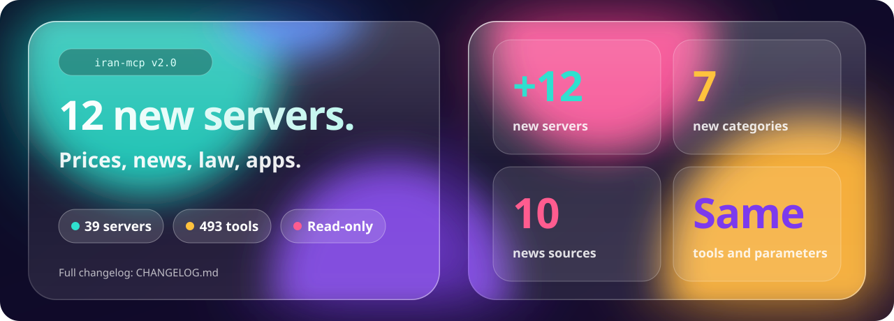

<div align="center">


**English** · [فارسی](README.fa.md)

# Iran MCP servers: iran-mcp

**Give your AI agent the Iranian web.**<br>
36 unofficial, open-source Persian-web MCP servers for Digikala, Torob, Divar, Snappfood, Jabama, MrBilit, Paziresh24, Taaghche, the Tehran stock exchange, Iranian crypto exchanges, the tax administration, qavanin.ir laws and more, plus official ones from ExirYab, Pasavard and SwapWallet.<br>
Search, compare prices in Toman, find free slots and today's deals from Claude, Cursor, GitHub Copilot in VS Code or any MCP client.<br>
Install them as Claude Code plugins with skills, or as Agent Skills for Codex, Cursor, Antigravity and Grok Build.

[](#the-servers)
[](TOOLS.md)
[](#quick-start)
[](https://registry.modelcontextprotocol.io/?q=sepehr071)
[](LICENSE)
[](https://github.com/sepehr071/iran-mcp)

[What's new](#whats-new-in-v20) · [Quick start](#quick-start) · [The servers](#the-servers) · [For AI agents](#for-ai-agents) · [All tools](TOOLS.md) · [FAQ](#faq)

</div>

---

## What's new in v2.0



- **12 new servers**, all read-only and without sign-in: 36 servers and 469 tools in total.
- **Shops and food:** [basalam-mcp](https://github.com/sepehr071/basalam-mcp) (thousands of small shops),
  [banimode-mcp](https://github.com/sepehr071/banimode-mcp) (fashion),
  [baneh-mcp](https://github.com/sepehr071/baneh-mcp) (appliances, TVs, tools) and
  [tapsifood-mcp](https://github.com/sepehr071/tapsifood-mcp) (dishes and deals near an address).
- **Prices, news and public records:** [tgju-mcp](https://github.com/sepehr071/tgju-mcp) (gold, coin, currency and
  crypto), [iran-news-mcp](https://github.com/sepehr071/iran-news-mcp) (10 news sources, plus a tech-news tool),
  [iran-quake-mcp](https://github.com/sepehr071/iran-quake-mcp) (earthquakes),
  [qavanin-mcp](https://github.com/sepehr071/qavanin-mcp) (national laws) and
  [iran-tax-mcp](https://github.com/sepehr071/iran-tax-mcp) (e-invoice IDs, VAT rates, tax rulings).
- **Courses, apps and software:** [maktabkhooneh-mcp](https://github.com/sepehr071/maktabkhooneh-mcp) (its tools start
  with `mkh_`), [iran-apps-mcp](https://github.com/sepehr071/iran-apps-mcp) (Cafe Bazaar and Myket) and
  [iran-downloads-mcp](https://github.com/sepehr071/iran-downloads-mcp) (download-site search, item page only, never a
  download link).
- **New bundles** `iran-fashion` and `iran-software`.
- Tool names and parameters of the existing servers are unchanged.

Full list: [CHANGELOG.md](CHANGELOG.md).

<details>
<summary><b>What's new in v1.7</b></summary>


- **Fewer blocks and failed calls.** The 18 unofficial shop servers now talk to each site like a normal browser,
  pace their requests and wait when a site asks them to slow down. On Torob the old client was blocked after 4-6
  calls; the new one made 100 without a block.
- **Proxy lists.** `<NAME>_MCP_PROXY` takes several proxies, separated by commas. When one is blocked, the next takes
  over.
- **Optional browser fallback** for sites that show a bot-check page: install `<package>[browser]`.
- **New: [torob-mcp](https://github.com/sepehr071/torob-mcp)** (every Iranian shop's price for one product),
  **[pasavard-mcp](https://github.com/ashkancapella/pasavard-mcp)** (hosted, best buys per budget) and
  **[exiryab-mcp](https://github.com/sshnevis/exiryab-mcp)** (ExirYab's own doctor finder).
- Tool names and parameters are unchanged.

Full list: [CHANGELOG.md](CHANGELOG.md).
</details>

<details>
<summary><b>What's new in v1.5</b></summary>


- **About 62% fewer tokens per tool call** and a 19% smaller tool list across the 19 package servers, with the same
  rankings and cheapest prices as before.
- **Security hardening** in 30book, Bale and Okala, and site text is treated as untrusted in every server.
- **Caches, parallel requests and retries** where the servers were slow or fragile.
- **New: [divar-mcp](https://github.com/sepehr071/divar-mcp)**, 31 tools for Divar classifieds: homes, cars, phones,
  fair-price checks and new-ad alerts.

Full list, including changes for callers: [CHANGELOG.md](CHANGELOG.md).
</details>

## Why

Iranian websites are not built for AI agents. Most have no public API, prices come in Rial on one page and Toman
on the next, and every site hides its best deals behind a different menu. Each package server here maps one site's
real (undocumented) API, tests it, and exposes it as clean MCP tools with prices in **Toman**. `exiryab-mcp`,
`pasavard-mcp` and `swapwallet-mcp` are the sites' own servers, built on their documented APIs.

Put a few of them together and one sentence does a day of tab-hopping (illustrative example):

> **You:** I'm flying Tehran to Kish next Thursday for 3 nights. Cheapest flight, a villa under 4 million Toman a
> night, and a dermatologist on the island with a free slot.
>
> **Agent:** *calls* `mrbilit` for flights → `jabama` and `otaghak` for stays → `paziresh24` for doctors
>
> | | Pick | Price (Toman) |
> |---|---|---:|
> | Flight | Thursday 07:40, economy, 2 seats left | 2,180,000 |
> | Stay | 2-bedroom villa near the beach, 4.8 stars | 3,650,000 / night |
> | Doctor | Dermatologist, Saturday 10:30, in-person | 450,000 |

## Quick start

Every server is a small Python package on PyPI, run with [`uvx`](https://docs.astral.sh/uv/), except
`pasavard-mcp` and `swapwallet-mcp`, which their sites host: you add them by URL, and sign in to SwapWallet once
with OAuth. The site servers need no
account and no API key. `payping-mcp` and `bale-mcp` work on your own account with your token, and `swapwallet-mcp`
with your SwapWallet sign-in.

**Claude Code plugins** (server + skill, pick what you want): add the marketplace once, then choose
servers in the `/plugin` Discover tab, or install by name.

```bash
claude plugin marketplace add sepehr071/iran-mcp
claude plugin install digikala@iran-mcp            # one server
claude plugin install iran-travel@iran-mcp         # a bundle: food, shopping, beauty, travel, health, books
claude plugin install iran-all@iran-mcp            # every read-only site server
```

`claude plugin install <name> --marketplace sepehr071/iran-mcp` does both steps in one command.
`payping`, `bale` and `swapwallet` act on your own account, so no bundle includes them; install them by name.
SwapWallet also publishes this server as its own plugin (`swapwallet@swapwallet`, from
[SwapWallet/swapwallet-mcp](https://github.com/SwapWallet/swapwallet-mcp)), with the same rules. Install one of the
two: with both you get the server twice.

**Skills for other agents** (Codex, Cursor, Gemini CLI, ...): pick the skills you want, then add each server
with the config below.

```bash
npx skills add sepehr071/iran-mcp
```

**Grok Build** reads the same marketplace: `grok plugin marketplace add sepehr071/iran-mcp`, then install
servers one by one (Grok doesn't install a bundle's members). Which agent supports what:
[PLUGINS.md](PLUGINS.md#compatibility).

**One server** (Claude Code, without the plugin):

```bash
claude mcp add digikala -- uvx digikala-mcp
claude mcp add --transport http swapwallet https://swapwallet.app/mcp   # hosted; then sign in from /mcp
claude mcp add --transport http pasavard https://pasavard.ir/api/mcp      # hosted, no sign-in
```

**Any MCP client** (Claude Desktop, Cursor, Windsurf, VS Code, ...):

```json
{
  "mcpServers": {
    "digikala": { "command": "uvx", "args": ["digikala-mcp"] },
    "jabama":   { "command": "uvx", "args": ["jabama-mcp"] }
  }
}
```

`swapwallet-mcp` is added by URL, and each client takes a URL in its own shape (Windsurf uses `serverUrl`, Claude
Desktop takes it under Settings → Connectors): see [its setup for each client](https://github.com/SwapWallet/swapwallet-mcp#connect).

**All 40 at once:** clone this repo and open it in Claude Code. The [`.mcp.json`](.mcp.json) at the root
registers every server; approve the ones you want.

```bash
git clone https://github.com/sepehr071/iran-mcp
cd iran-mcp && claude
```

> [!TIP]
> 500 tools is a lot of context. Enable the servers for the task at hand rather than all of them.

## The servers

### 🛒 Shopping

| Server | Site | Tools | Version | Updated | What your agent can do |
|---|---|---:|:---:|:---:|---|
| [digikala-mcp](https://github.com/sepehr071/digikala-mcp) | [Digikala](https://www.digikala.com) (incl. Fresh) | 23 | [](https://pypi.org/project/digikala-mcp/) | [](https://github.com/sepehr071/digikala-mcp/commits/main) | Search with feature filters, best picks for a budget, every seller, price history, reviews, deals |
| [technolife-mcp](https://github.com/sepehr071/technolife-mcp) | [Technolife](https://www.technolife.com) | 19 | [](https://pypi.org/project/technolife-mcp/) | [](https://github.com/sepehr071/technolife-mcp/commits/main) | Electronics: each seller's cash and installment price, specs, reviews, deals |
| [masterkala-mcp](https://github.com/sepehr071/masterkala-mcp) | [MasterKala](https://masterkala.com) | 14 | [](https://pypi.org/project/masterkala-mcp/) | [](https://github.com/sepehr071/masterkala-mcp/commits/main) | Gadgets and accessories: prices, specs, deals |
| [baneh-mcp](https://github.com/sepehr071/baneh-mcp) | [Baneh](https://baaneeh.com) | 7 | [](https://pypi.org/project/baneh-mcp/) | [](https://github.com/sepehr071/baneh-mcp/commits/main) | Appliances, TVs and electronics: cheapest in-stock price, brands, reviews |
| [torob-mcp](https://github.com/sepehr071/torob-mcp) | [Torob](https://torob.com) (price comparison) | 26 | [](https://pypi.org/project/torob-mcp/) | [](https://github.com/sepehr071/torob-mcp/commits/main) | Every shop's price for a product, price history, deal checks, installments, cheapest shop for a basket |
| [basalam-mcp](https://github.com/sepehr071/basalam-mcp) | [Basalam](https://basalam.com) (marketplace) | 7 | [](https://pypi.org/project/basalam-mcp/) | [](https://github.com/sepehr071/basalam-mcp/commits/main) | Goods from thousands of small shops: price, shipping and discount filters, cheapest offers, shop ratings, reviews |
| [shopino-mcp](https://github.com/sepehr071/shopino-mcp) | [Shopino](https://shopino.app) | 14 | [](https://pypi.org/project/shopino-mcp/) | [](https://github.com/sepehr071/shopino-mcp/commits/main) | Fashion from thousands of shops: prices, sizes, stock, shop ratings |
| [banimode-mcp](https://github.com/sepehr071/banimode-mcp) | [Banimode](https://www.banimode.com) | 7 | [](https://pypi.org/project/banimode-mcp/) | [](https://github.com/sepehr071/banimode-mcp/commits/main) | Fashion: prices, sizes, stock, brands, deals, reviews |
| [pasavard-mcp](https://github.com/ashkancapella/pasavard-mcp) | [Pasavard](https://pasavard.ir) (official, hosted) | 4 | [](https://github.com/ashkancapella/pasavard-mcp/blob/main/server.json) | [](https://github.com/ashkancapella/pasavard-mcp/commits/main) | Digikala and Snappshop prices tracked hourly: best picks per budget against each product's 30-day low, with affiliate and cashback links |

### 🏠 Classifieds

| Server | Site | Tools | Version | Updated | What your agent can do |
|---|---|---:|:---:|:---:|---|
| [divar-mcp](https://github.com/sepehr071/divar-mcp) | [Divar](https://divar.ir) | 31 | [](https://pypi.org/project/divar-mcp/) | [](https://github.com/sepehr071/divar-mcp/commits/main) | Homes, cars, phones and more in any city: cheapest and best-value ads, fair-price check, market stats, new-ad alerts |

### 💄 Beauty

| Server | Site | Tools | Version | Updated | What your agent can do |
|---|---|---:|:---:|:---:|---|
| [khanoumi-mcp](https://github.com/sepehr071/khanoumi-mcp) | [Khanoumi](https://www.khanoumi.com) | 12 | [](https://pypi.org/project/khanoumi-mcp/) | [](https://github.com/sepehr071/khanoumi-mcp/commits/main) | Cosmetics, skin and hair care, perfume: prices, shades, reviews, deals |
| [asalbanoo-mcp](https://github.com/sepehr071/asalbanoo-mcp) | [Asal Banoo](https://asalbanooshop.com) | 12 | [](https://pypi.org/project/asalbanoo-mcp/) | [](https://github.com/sepehr071/asalbanoo-mcp/commits/main) | Cosmetics and hair care: prices, variants, deals |

### 🍕 Food and groceries

| Server | Site | Tools | Version | Updated | What your agent can do |
|---|---|---:|:---:|:---:|---|
| [snapp-mcp](https://github.com/sepehr071/snapp-mcp) | [Snappfood](https://snappfood.ir) + [SnappMarket](https://snapp.market) | 21 | [](https://pypi.org/project/snapp-mcp/) | [](https://github.com/sepehr071/snapp-mcp/commits/main) | Cheapest dish near you, menus, FoodParty flash deals, groceries |
| [okala-mcp](https://github.com/sepehr071/okala-mcp) | [Okala](https://okala.com) | 16 | [](https://pypi.org/project/okala-mcp/) | [](https://github.com/sepehr071/okala-mcp/commits/main) | Grocery stores that deliver to you, prices across stores, deals |
| [tapsifood-mcp](https://github.com/sepehr071/tapsifood-mcp) | [Tapsi Food](https://tapsi.food) | 11 | [](https://pypi.org/project/tapsifood-mcp/) | [](https://github.com/sepehr071/tapsifood-mcp/commits/main) | Dishes and restaurants near you, menus, flash deals, discounted restaurants, reviews |

### ✈️ Travel and stays

| Server | Site | Tools | Version | Updated | What your agent can do |
|---|---|---:|:---:|:---:|---|
| [mrbilit-mcp](https://github.com/sepehr071/mrbilit-mcp) | [MrBilit](https://mrbilit.com) | 22 | [](https://pypi.org/project/mrbilit-mcp/) | [](https://github.com/sepehr071/mrbilit-mcp/commits/main) | Cheapest flights, trains, buses, taxis and hotels; seats and refund rules |
| [flytoday-mcp](https://github.com/sepehr071/flytoday-mcp) | [Flytoday](https://www.flytoday.ir) | 22 | [](https://pypi.org/project/flytoday-mcp/) | [](https://github.com/sepehr071/flytoday-mcp/commits/main) | Flights, trains, buses, hotels, villas; CIP, eSIM, visas, activities |
| [jabama-mcp](https://github.com/sepehr071/jabama-mcp) | [Jabama](https://www.jabama.com), [Jabama Tours](https://jabama.tours), [Jabama Events](https://jabama.events) | 21 | [](https://pypi.org/project/jabama-mcp/) | [](https://github.com/sepehr071/jabama-mcp/commits/main) | Stays with exact prices, group tours, events and theater tickets |
| [otaghak-mcp](https://github.com/sepehr071/otaghak-mcp) | [Otaghak](https://www.otaghak.com) | 15 | [](https://pypi.org/project/otaghak-mcp/) | [](https://github.com/sepehr071/otaghak-mcp/commits/main) | Villas and cottages: availability, exact stay price, reviews, hosts |

### 🩺 Health

| Server | Site | Tools | Version | Updated | What your agent can do |
|---|---|---:|:---:|:---:|---|
| [paziresh24-mcp](https://github.com/sepehr071/paziresh24-mcp) | [Paziresh24](https://www.paziresh24.com) | 12 | [](https://pypi.org/project/paziresh24-mcp/) | [](https://github.com/sepehr071/paziresh24-mcp/commits/main) | Doctors, visit prices, reviews, free appointment slots |
| [doctoreto-mcp](https://github.com/sepehr071/doctoreto-mcp) | [Doctoreto](https://doctoreto.com) | 14 | [](https://pypi.org/project/doctoreto-mcp/) | [](https://github.com/sepehr071/doctoreto-mcp/commits/main) | Doctors, visit fees, free slots, reviews, clinics, labs, offers |
| [exiryab-mcp](https://github.com/sshnevis/exiryab-mcp) | [ExirYab](https://exiryab.com) (official) | 3 | [](https://pypi.org/project/exiryab-mcp/) | [](https://github.com/sshnevis/exiryab-mcp/commits/main) | Find a doctor by name, city and specialty: profile, clinics, phones, hours, map location |

### 📚 Books

| Server | Site | Tools | Version | Updated | What your agent can do |
|---|---|---:|:---:|:---:|---|
| [taaghche-mcp](https://github.com/sepehr071/taaghche-mcp) | [Taaghche](https://taaghche.com) | 12 | [](https://pypi.org/project/taaghche-mcp/) | [](https://github.com/sepehr071/taaghche-mcp/commits/main) | Ebooks and audiobooks: prices, discounts, reviews, bestsellers, free books |
| [fidibo-mcp](https://github.com/sepehr071/fidibo-mcp) | [Fidibo](https://fidibo.com) | 11 | [](https://pypi.org/project/fidibo-mcp/) | [](https://github.com/sepehr071/fidibo-mcp/commits/main) | Ebooks and audiobooks: prices, Fidibo Plus, reviews, bestsellers, free books |
| [30book-mcp](https://github.com/sepehr071/30book-mcp) | [30book](https://www.30book.com) | 14 | [](https://pypi.org/project/30book-mcp/) | [](https://github.com/sepehr071/30book-mcp/commits/main) | Printed books: list and discounted price, stock, editions, ISBN, deals |

### 🎓 Learning, apps and downloads

| Server | Site | Tools | Version | Updated | What your agent can do |
|---|---|---:|:---:|:---:|---|
| [maktabkhooneh-mcp](https://github.com/sepehr071/maktabkhooneh-mcp) | [Maktabkhooneh](https://maktabkhooneh.org) | 12 | [](https://pypi.org/project/maktabkhooneh-mcp/) | [](https://github.com/sepehr071/maktabkhooneh-mcp/commits/main) | Persian online courses: cheapest and free courses, deals, curriculum, teachers, reviews |
| [iran-apps-mcp](https://github.com/sepehr071/iran-apps-mcp) | [Cafe Bazaar](https://cafebazaar.ir) and [Myket](https://myket.ir) | 6 | [](https://pypi.org/project/iran-apps-mcp/) | [](https://github.com/sepehr071/iran-apps-mcp/commits/main) | Android apps: search, compare across both stores, top lists, similar apps |
| [iran-downloads-mcp](https://github.com/sepehr071/iran-downloads-mcp) | [Soft98](https://soft98.ir), [P30Download](https://p30download.ir), [Downloadly](https://downloadly.ir), [VGDL](https://vgdl.ir) | 4 | [](https://pypi.org/project/iran-downloads-mcp/) | [](https://github.com/sepehr071/iran-downloads-mcp/commits/main) | Metadata-only search of software and game download sites: returns the item page, never a download link |

### 📊 Prices, news and public records

| Server | Site | Tools | Version | Updated | What your agent can do |
|---|---|---:|:---:|:---:|---|
| [tgju-mcp](https://github.com/sepehr071/tgju-mcp) | [TGJU](https://www.tgju.org) | 6 | [](https://pypi.org/project/tgju-mcp/) | [](https://github.com/sepehr071/tgju-mcp/commits/main) | Live gold, coin, dollar, euro and crypto prices, market tables, daily history |
| [iran-crypto-mcp](https://github.com/sepehr071/iran-crypto-mcp) | [Nobitex](https://nobitex.ir), [Wallex](https://wallex.ir), [Bitpin](https://bitpin.ir), [Ramzinex](https://ramzinex.com), [Tabdeal](https://tabdeal.org), [OMPFinex](https://ompfinex.com), [Exir](https://exir.io) | 12 | [](https://pypi.org/project/iran-crypto-mcp/) | [](https://github.com/sepehr071/iran-crypto-mcp/commits/main) | Compare a coin's price across 7 exchanges in Toman, order books, trades, candles, top movers |
| [milligold-mcp](https://github.com/sepehr071/milligold-mcp) | [Milli.gold](https://milli.gold) | 8 | [](https://pypi.org/project/milligold-mcp/) | [](https://github.com/sepehr071/milligold-mcp/commits/main) | Live 18k gold price per gram, history, fees and trade cost quotes, latest news and help articles, platform statistics |
| [iran-gold-mcp](https://github.com/sepehr071/iran-gold-mcp) | [Milli.gold](https://milli.gold), [Wallgold](https://wallgold.ir), [Melligold](https://melligold.com), [Daric](https://daric.gold), [Taline](https://taline.ir) | 3 | [](https://pypi.org/project/iran-gold-mcp/) | [](https://github.com/sepehr071/iran-gold-mcp/commits/main) | Compare the live 18k gold buy and sell price per gram on 5 platforms in Toman, cheapest to buy and best to sell, Milli.gold history |
| [tsetmc-mcp](https://github.com/sepehr071/tsetmc-mcp) | [TSETMC](https://tsetmc.com) | 8 | [](https://pypi.org/project/tsetmc-mcp/) | [](https://github.com/sepehr071/tsetmc-mcp/commits/main) | Tehran Stock Exchange quotes, movers, order book, history, indices, real versus legal trading (Rial) |
| [iran-news-mcp](https://github.com/sepehr071/iran-news-mcp) | [Mehr](https://www.mehrnews.com), [Khabaronline](https://www.khabaronline.ir), [Hamshahri](https://www.hamshahrionline.ir), [Tabnak](https://www.tabnak.ir), [Entekhab](https://www.entekhab.ir), [Asriran](https://www.asriran.com), [Zoomit](https://www.zoomit.ir), [Digiato](https://digiato.com), [Varzesh3](https://www.varzesh3.com), [Khabarvarzeshi](https://www.khabarvarzeshi.com) | 6 | [](https://pypi.org/project/iran-news-mcp/) | [](https://github.com/sepehr071/iran-news-mcp/commits/main) | Latest headlines by source and category, keyword search, full article text |
| [iran-quake-mcp](https://github.com/sepehr071/iran-quake-mcp) | [IRSC](https://irsc.ut.ac.ir), [USGS](https://earthquake.usgs.gov), [EMSC](https://www.emsc-csem.org) | 5 | [](https://pypi.org/project/iran-quake-mcp/) | [](https://github.com/sepehr071/iran-quake-mcp/commits/main) | Latest and strongest earthquakes in Iran, history search, event detail, activity stats |
| [qavanin-mcp](https://github.com/sepehr071/qavanin-mcp) | [qavanin.ir](https://qavanin.ir) | 7 | [](https://pypi.org/project/qavanin-mcp/) | [](https://github.com/sepehr071/qavanin-mcp/commits/main) | 168,000 laws, regulations and court votes: search, full text, one article, amendments, related documents |
| [iran-tax-mcp](https://github.com/sepehr071/iran-tax-mcp) | [tax.gov.ir](https://tax.gov.ir), [stuffid.tax.gov.ir](https://stuffid.tax.gov.ir), [regulation.tax.gov.ir](https://regulation.tax.gov.ir) | 6 | [](https://pypi.org/project/iran-tax-mcp/) | [](https://github.com/sepehr071/iran-tax-mcp/commits/main) | E-invoice goods/service IDs with VAT rate, activity codes, property transaction values, tax laws and circulars, official FAQ |

### 💳 Your own accounts (need a token or sign-in)

| Server | Site | Tools | Version | Updated | What your agent can do |
|---|---|---:|:---:|:---:|---|
| [payping-mcp](https://github.com/sepehr071/payping-mcp) | [PayPing](https://www.payping.ir) | 21 | [](https://pypi.org/project/payping-mcp/) | [](https://github.com/sepehr071/payping-mcp/commits/main) | Read balance, sales, customers; create products, payment links, coupons, invoices |
| [bale-mcp](https://github.com/sepehr071/bale-mcp) | [Bale](https://bale.ai) messenger | 13 | [](https://pypi.org/project/bale-mcp/) | [](https://github.com/sepehr071/bale-mcp/commits/main) | Read and answer your bot's messages, ask and wait for replies, send files |
| [swapwallet-mcp](https://github.com/SwapWallet/swapwallet-mcp) | [SwapWallet](https://swapwallet.app) (official, hosted) | 13 | [](https://registry.modelcontextprotocol.io/v0.1/servers/app.swapwallet%2Fmcp/versions/latest) | [](https://github.com/SwapWallet/swapwallet-mcp/commits/main) | Read balances, P&L and history; request swaps, transfers and withdrawals that run only after you approve them in Telegram |

Every tool, with a one-line summary: [TOOLS.md](TOOLS.md).

## For AI agents

This repo is built to be read by agents as much as by people:

| File | What it is |
|---|---|
| [`AGENTS.md`](AGENTS.md) | Which server to pick for which task, conventions, safety rules, how to work in this repo |
| [`servers.json`](servers.json) | Machine-readable catalog: package or URL, version, category, env vars and every tool of each server |
| [`TOOLS.md`](TOOLS.md) | All 500 tools grouped by server, one line each |
| [`llms.txt`](llms.txt) | Short index for LLMs ([llmstxt.org](https://llmstxt.org)) |
| [`.mcp.json`](.mcp.json) | Ready-to-use config for every server |
| [`.claude-plugin/marketplace.json`](.claude-plugin/marketplace.json) | The `iran-mcp` plugin marketplace: one plugin per server plus bundles |
| [`plugins/`](plugins) | Each plugin: its MCP server (a package pinned to a release, or a hosted server's URL) and a `SKILL.md` with when to use it and its rules |
| [`PLUGINS.md`](PLUGINS.md) | Agent compatibility, and how a server release reaches plugin users |

Paste this into your agent to set it up:

```text
Read https://raw.githubusercontent.com/sepehr071/iran-mcp/main/AGENTS.md, then add the MCP servers I need for <task> to my MCP config.
```

## Shared conventions

- **Prices are always Toman**, even where the site's API returns Rial.
- **Site servers are read-only.** Shop, travel, health and book servers never log in, fill a basket, book or pay.
  `payping-mcp` and `bale-mcp` can write, but only to your own account, with your token, on your machine.
  `swapwallet-mcp` works on your own SwapWallet account after you sign in, and a swap, transfer or withdrawal it asks
  for runs only after you approve it in Telegram.
- **Images:** product, stay, hotel and doctor results carry an `image` URL where the site has one.
- **Proxy:** every package server reads an optional `<NAME>_MCP_PROXY` env var (e.g. `DIGIKALA_MCP_PROXY`) for sites
  that block your IP. System proxy settings are ignored. See [`servers.json`](servers.json) for exact names.
- Same layout for every package server: `src/<pkg>/http.py`, `registry.py`, `server.py`, offline tests on recorded fixtures,
  `-m live` tests against the real site, published to PyPI and the [MCP Registry](https://registry.modelcontextprotocol.io).

## Working from source

Each server lives in its own repo and is pinned here as a git submodule under `servers/`. A hosted server's repo
holds its `server.json` and client configs, not its code; `catalog.py` reads its tools from the server card it
publishes.

```bash
git clone --recurse-submodules https://github.com/sepehr071/iran-mcp
cd iran-mcp/servers/digikala-mcp
uv sync && uv run pytest -q          # offline tests
uv run pytest -m live -q             # against the real site
```

Pull every server to its latest `main` and rebuild the catalog:

```bash
git submodule update --init --remote
python scripts/catalog.py            # rewrites servers.json, TOOLS.md, .mcp.json, plugins/, .claude-plugin/
python scripts/banner.py             # redraws the banners with the new counts
claude plugin validate .             # checks the marketplace and every plugin
```

A nightly GitHub Action does all of this and commits the result. The full release flow is in [PLUGINS.md](PLUGINS.md).

Bugs and feature requests for a server go to that server's own repo.

## FAQ

<details>
<summary><b>Are these official?</b></summary>

All but three are unofficial and not affiliated with the sites. They call the same endpoints the sites' own web
apps use. Those APIs are undocumented and can change; open an issue on the server's repo when one breaks.
`swapwallet-mcp` is SwapWallet's own server, documented at [swapwallet.app/docs/mcp](https://swapwallet.app/docs/mcp).
`exiryab-mcp` is ExirYab's own server, on the public API listed in [exiryab.com/llms.txt](https://exiryab.com/llms.txt).
`pasavard-mcp` is Pasavard's own hosted server; its store links are affiliate links, and every result says so.
</details>

<details>
<summary><b>A site times out or returns 403 from outside Iran.</b></summary>

Some sites block foreign IPs. Set that server's proxy variable, e.g. `DIGIKALA_MCP_PROXY=http://127.0.0.1:8080`,
to a proxy with an Iranian exit.
</details>

<details>
<summary><b>Can my agent order or pay for me?</b></summary>

Not on the sites: the site servers are read-only on purpose. Your agent finds and compares; you buy. The exception
is your own SwapWallet account: with `swapwallet-mcp` your agent can ask for a swap, transfer or withdrawal, and nothing
moves until you approve it in Telegram.
</details>

<details>
<summary><b>Do I need Python?</b></summary>

You need [uv](https://docs.astral.sh/uv/getting-started/installation/). `uvx` downloads the right Python and the
package on first run. `pasavard-mcp` and `swapwallet-mcp` run on their sites' servers and need nothing installed.
</details>

<details>
<summary><b>How do I get updates?</b></summary>

Plugins pin each package server to a release, so a plugin update is a server update. `pasavard-mcp` and `swapwallet-mcp` are hosted:
they change whenever their sites deploy them, and a plugin update only brings a new skill. Turn on auto-update once in
`/plugin` → **Marketplaces** → `iran-mcp`, or run `claude plugin update <name>@iran-mcp`. A plain
`uvx digikala-mcp` config keeps running its cached copy; run `uvx digikala-mcp@latest --help` once and restart
your client to upgrade it.
</details>

If this saves you some tab-hopping, a star on the repo helps other people find it.

## Author

<a href="https://www.linkedin.com/in/sepehr-radmard"></a>

Built and maintained by **Sepehr Radmard** (سپهر رادمرد). Connect on [LinkedIn](https://www.linkedin.com/in/sepehr-radmard) or follow [@sepehr071 on GitHub](https://github.com/sepehr071) for more MCP servers for Iranian websites. If this repo saves you some tab-hopping, a star helps other people find it.

## License

[MIT](LICENSE). Each package server is MIT licensed in its own repo. Site names, logos and trademarks belong to their owners and are shown only to identify each site.
